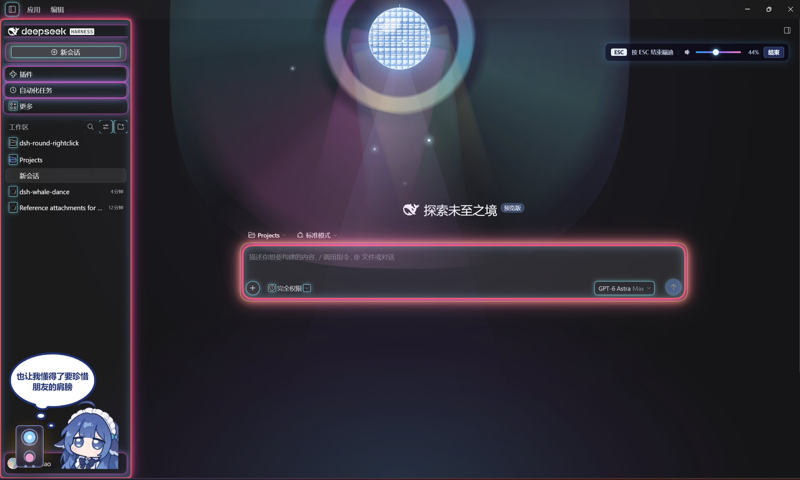

# dsh-whale-dance · whale dance on one lyric line

Send one lyric line in the chat box; the AI identifies the song, ranks Bilibili versions by views, streams the audio, and the whale widget starts carrying a speaker around the window.

```
You: 哦耶耶，桃花谢了有玫瑰
AI: Found 《朋友的酒》 by 李晓杰 / 玉萨 — Bilibili DJ remix. Press ESC to stop.
```



[中文说明](README.md) · [Changelog](CHANGELOG.md) · MIT License

## What you get

- The **real** whale widget carries the speaker to its left, travels left/right and bounces with Q-elastic squash and stretch;
- Bounce is driven by a beat spring; the window pulses ~6px per beat (no high-frequency jitter);
- A round faceted disco ball hangs at the top center: mirror facets, rainbow halo, three sweeping colored rays, beat-scaled size, floor light pool;
- Lyrics are **injected into the widget's own native bubble** (no extra bubble) and cycle key lines; the per-turn cost bubble is suppressed during the dance;
- Composer, sidebar, sidebar rows, icons and right-aligned user bubbles all get **rainbow neon strips** (pink/cyan/yellow/green, 1.1–1.4s per cycle); positions are measured from the real DOM and re-aligned after window resize/maximize/sidebar collapse;
- "Golden legend" finish: a warm gold halo around the speaker and a gold outline around the composer;
- Every 12 beats, one random whole-page transition: ① 1.8s two turns; ② 3.6s one turn; ③ 3.6s split with the left half spinning clockwise and the right half counter-clockwise; the first two shrink during the first half and grow back during the second;
- Top-right bar with the ESC hint, a **volume slider** (persisted in the browser, reused on the next song) and a Stop button;
- **ESC**, the Stop button, or the end of the track stops everything immediately.

## Requirement

Install the whale widget first: [`dsh-whale-widget`](https://github.com/MeteorNOX/DeepSeek-Balance-Whale-Widget).

Without it the plugin shows an install hint and still plays music, lights, shake and lyrics — but no whale and no speaker. No API keys are needed; only public Bilibili and NetEase endpoints are used.

## How it is triggered

Send a lyric line or a song name: `哦耶耶，桃花谢了有玫瑰`, `你是我的小呀小苹果`, `来首朋友的酒，DJ版`.

## Version selection

1. The model confirms the song name first;
2. It calls `whale_dance_search` — a search-only tool that returns candidates sorted by Bilibili views (BV, title, uploader, views, duration, plus DJ/cover/instrumental/remix/HONK flags) and the top DJ vs top non-DJ candidate;
3. The model passes the chosen `bvid` to `whale_dance`, which plays exactly that video.

Priority: explicit user instruction → content/instrument/character clues → compare views (the higher-viewed DJ or non-DJ version wins) → title fit and duration, excluding unrelated covers, HONK, unrelated remixes and long compilations. "Original" here means the rendition the user asked for, not necessarily the official original song.

## Audio and lyrics

NetEase resolves the song and lyrics (LRC first, Bilibili subtitles as fallback); key lines are picked and cycled. Audio comes from the Bilibili track: **about 4 seconds are prebuffered, playback starts immediately, the rest keeps streaming while the route serves the growing file**; NetEase mp3 is the fallback, and a synthesized beat keeps the dance alive if both fail.

Cache: `$DSH_HOME/.dsh-whale-dance/` (24 tracks max; files still streaming are never cleaned).

## Install

```sh
dsh plugin --profile <profile> add dsh-whale-dance      # npm
dsh plugin --profile <profile> add github:hmr-BH/dsh-whale-dance
dsh plugin --profile <profile> add link:<absolute path>
```

Restart DSH and refresh the page. Client-only changes need a page refresh; host changes need a plugin reload.

## Tests

```sh
npm test   # lookup, routes, streaming
```

## Privacy

Only `api.bilibili.com`, `music.163.com` and their audio CDNs are contacted, and only the song name/lyric fragment is sent. No API keys, cookies or session content are read or stored. The browser only calls same-origin `/dsh-dance/*` routes guarded by the DSH connection fence.

## License

[MIT](LICENSE)
