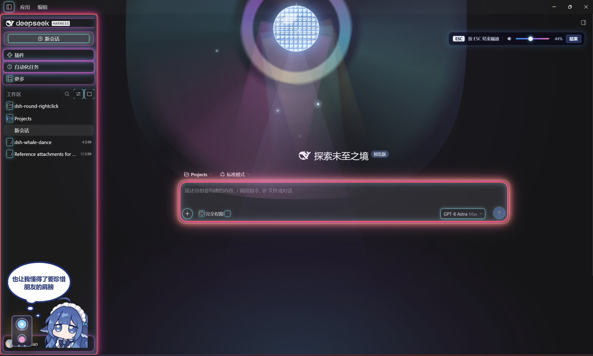

# dsh-whale-dance · 小鲸鱼蹦迪一键跟跳

在聊天框里发一句歌词，AI 自动确认歌曲、按 B 站播放量挑版本、流式播放，小鲸鱼挂件立刻抱着音响开始蹦迪。

```
你：哦耶耶，桃花谢了有玫瑰
AI：已找到《朋友的酒》—— 李晓杰 / 玉萨，B 站 DJ 版，按 ESC 结束蹦迪。
```




## 会看到什么

- 小鲸鱼挂件**本身**抱着左侧的音响，在窗口下半区左右往返，同时做 Q 弹蹦跳（起跳拉长、落地压扁、带回弹）；
- 蹦跳由节拍弹簧驱动；窗口随每拍做一次短促轻震（约 6px），不再高频乱抖；
- 上方正中是一颗圆形分面迪斯科球：镜面网格、彩虹光环、三束扫射彩色光、随拍放大、底部光池；
- 歌词**直接注入挂件自己的原生气泡**（不再新开气泡），循环展示关键句；蹦迪期间会压住「上一轮对话消耗」气泡；
- 聊天框、侧边栏、侧边栏条目、图标和右侧对齐的用户发言气泡都会亮起**全彩霓虹灯带**（粉/青/黄/绿循环，约 1.1–1.4 秒一轮）；位置按真实元素测量，窗口缩放/最大化/侧栏折叠后自动重新对齐；
- 「金色传说」质感：音响周围一圈暖金呼吸光晕，聊天输入框外围一圈金色描边；
- 每 12 拍随机挑一拍，触发三种整页转场之一：① 1.8 秒转两圈；② 3.6 秒转一圈；③ 3.6 秒从中间分裂，左半顺时针、右半逆时针各转一圈；前两种带「前半程缩小、后半程放大回正」；
- 右上角有 ESC 提示、**音量条**（0–100%，数值写入浏览器本地，下次播放沿用）和「结束」按钮；
- 按 **ESC**、点「结束」或音乐播完都会立即停下：音乐停止、挂件复原、灯光与霓虹消失。

## 前置

推荐先安装小鲸鱼挂件：[`dsh-whale-widget`](https://github.com/MeteorNOX/DeepSeek-Balance-Whale-Widget)。

没装时会提示去「插件」页面安装；此时触发蹦迪仍会播放音乐、灯光、抖动和歌词，但**不显示鲸鱼与音响**（不会用假鲸鱼替代）。

无需任何 API key，插件只访问 B 站与网易云的公开接口。

## 怎么触发

发歌词/歌曲开头即可：

- `哦耶耶，桃花谢了有玫瑰`
- `你是我的小呀小苹果`
- `来首朋友的酒，DJ版`
- `来首歌`（会请用户再补一句歌词或歌名，不会随机播放）

## 选版与播放流程

模型按三步走：

1. **先确认歌名**：用搜索能力按歌词/描述确认是哪首歌；
2. **调用 `whale_dance_search`**：工具只搜索不播放，返回按 B 站播放量从高到低排序的候选（BV、标题、UP 主、播放量、时长，以及 DJ/翻唱/纯音乐/混编/HONK 标记），并额外给出「DJ 最高 / 非 DJ 最高」的对照；
3. **模型选定一个 `bvid` 交给 `whale_dance`**：工具严格播放这个视频，不再自动改选。

选版优先级（写在插件提示词里）：

1. 用户明确指令最高（「不要 DJ / 要原版」「要 DJ 版」、点名 BV/UP 主）；
2. 再锁定用户想听的内容线索（琵琶、司凤、1.2x、纯音乐、Hi-Res…）；
3. 在锁定范围内比较播放量：**DJ 版播放量更高就播 DJ，非 DJ 更高就播非 DJ**；
4. 播放量接近时再看标题贴合度与时长，并排除无关翻唱、HONK、无关混编和超长合集。

这里的「原版」指**用户所指内容的那个演绎**：要琵琶曲就播琵琶演奏版（哪怕带 1.2x/DJ），要《雨爱》就播播放量最高的「雨爱司凤版」，而不是官方原曲或无关翻唱。

## 播放与歌词

1. 网易云确认歌曲，拿到歌名与歌手；
2. B 站搜「歌名 DJ」与「歌名」，按播放量、标题命中、时长排序，避开几十分钟串烧合集；
3. 歌词优先取与版本对应的网易云 LRC，其次另一版本，再退到 B 站字幕；展示时只挑重复度高的关键句（副歌优先）循环，不做逐句时间轴对齐；
4. 音频取 B 站音轨：**先攒约 4 秒数据就开始播放（约 3–4 秒预缓冲），剩余部分后台续传、路由边增长边下发**，不必等整首下完；B 站失败时用网易云外链 mp3 兜底；都失败时浏览器用合成节拍继续蹦。

缓存位于 `$DSH_HOME/.dsh-whale-dance/`（默认 `~/.dsh/.dsh-whale-dance/`），最多保留最近 24 首；仍在流式下载的文件不会被清理。

## 安装

### npm（推荐）

```sh
dsh plugin --profile <profile> add dsh-whale-dance
```

### GitHub

```sh
dsh plugin --profile <profile> add github:hmr-BH/dsh-whale-dance
```

### 本地目录

```sh
dsh plugin --profile <profile> add link:<本目录绝对路径>
```

### Release 包

从 [Releases](https://github.com/hmr-BH/dsh-whale-dance/releases) 下载 `dsh-whale-dance-1.0.0.tgz`，然后：

```sh
dsh plugin --profile <profile> add ./dsh-whale-dance-1.0.0.tgz
```

安装后重启 DSH 并刷新页面。后续只改 `client.js` 时刷新页面即可；改 `index.js` 需要重载插件。插件会检测页面里的动画版本，过旧时会提示先按 `Ctrl+F5`。

## 发布与 CI

- `main` 上的代码即发布源；打 tag（形如 `v1.0.0`）并发布 GitHub Release 后，`.github/workflows/release.yml` 会先校验 tag 与 `package.json` 的版本一致，再经 npm Trusted Publishing（OIDC）执行 `npm publish --access public --provenance`，不需要任何长期 token。
- 本地手工发布：`npm publish --registry=https://registry.npmjs.org --access public`。
- 打包检查：`npm pack`，产物在 `artifacts/`。

## 开发与测试

- `index.js`：宿主半区（工具、提示词、状态/音频/结束路由、B 站与网易云解析、流式音频）；
- `client.js`：浏览器半区（`shell.overlay` 舞台、移动真实挂件、音响、原生气泡歌词、迪斯科球、转场、霓虹与金色光晕、音量条）；
- `test/lookup.mjs`：真实网络的解析自测；
- `test/routes.mjs`：真实 HTTP 路由与工具串联冒烟测试；
- `test/stream.mjs`：预缓冲与流式续传测试。

```sh
npm test
```

## 网络与隐私

- 宿主只请求 `api.bilibili.com`、`music.163.com` 及其音频 CDN，只发送歌名/歌词片段；
- 不读取、不保存任何 API key、账号 cookie 或会话内容；
- 浏览器端只请求本机的 `/dsh-dance/*` 同源路由，与 DSH 的浏览器信任栅栏共用同一套校验。

## 限制

- B 站/网易云公开接口受地区、版权与风控影响，个别歌曲可能无歌词、无音频或只有某一版本；
- 音频为 B 站视频音轨，可能包含前奏口播或视频内其它声音；
- 节拍来自低频起音检测；没有明显鼓点时使用约 128 BPM 兜底节拍，跳动不一定完全对应编曲；
- 歌词只展示关键句并循环，不与 B 站视频时间轴逐句对齐；
- 跟随系统「减少动态效果」：开启后停止旋转类动画并减小跳动幅度；
- 只在 DSH 网页界面生效（Web 与桌面客户端的网页界面；CLI/TUI 无可显示界面）。

## 许可证

[MIT](LICENSE)
